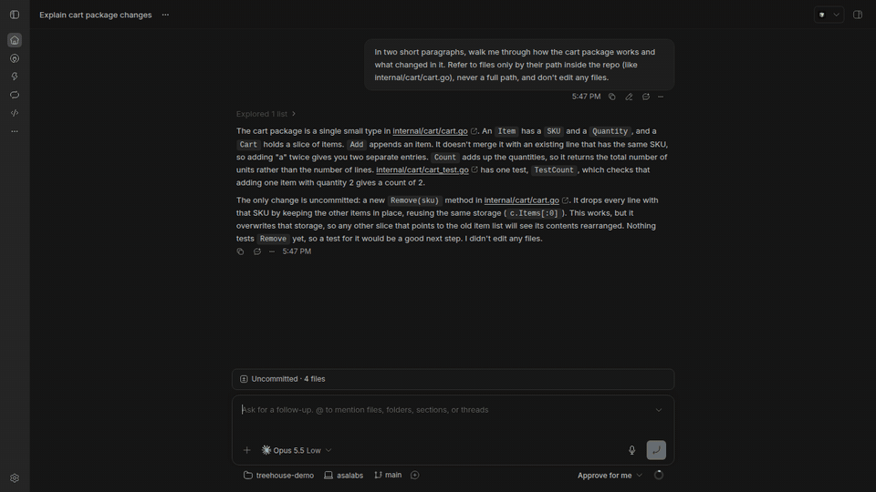

<div align="center">

# 🌳 Treehouse

**See everything your agents changed, across every worktree and repository, without leaving the thread.**

A file tree, a multi-repo Git panel and a commit graph for [bb](https://getbb.app), living right beside your agent's chat.

[](https://github.com/redhajuanda/bb-treehouse/releases)
[](https://getbb.app)



</div>

```sh
bb plugin install git:https://github.com/redhajuanda/bb-treehouse@^0.2.0 --yes
```

Open any thread's side panel, pick **Files** (or press <kbd>Ctrl</kbd>/<kbd>⌘</kbd>+<kbd>Shift</kbd>+<kbd>E</kbd>), and you're in.

## Why Treehouse?

Agents don't work in one tidy repo. They spread out across `.worktrees/`, nested service repos and feature branches, and you end up jumping to a terminal or another editor just to see what happened. Treehouse puts it all one click away, in the same panel as the conversation:

- 🗂️ **Every repository, one panel.** Treehouse finds every git repo in the workspace, worktrees and nested repos included, and gives each its own section.
- ⚡ **Live, not polled.** Changes appear the moment an agent saves a file or you run `git` in a terminal, using bb's native file watcher. Idle workspaces cost nothing.
- ✨ **Commit in seconds.** Claude writes the commit message in your repo's own style. Review it, hit <kbd>⌘</kbd>+<kbd>Enter</kbd>, done.
- 🔀 **From branch to PR without leaving bb.** Compare any branch against `main`, then open a pull request on GitHub, GitLab or Bitbucket in one click.
- 🧭 **Feels native.** bb's own theme, keyboard navigation, VS Code-style file icons, and views that remember exactly where you were.

## Three views, one tab

### 📁 Files: the tree you wish your agent panel had

- Icons for 200+ file types (Go, TypeScript, Docker, Terraform, …) and 170+ well-known folders, from Material Icon Theme.
- Git status right in the tree: **M**odified, **U**ntracked, **A**dded and **D**eleted, coloured all the way up the folder path.
- Jump between the workspace, any worktree or any nested repo from a searchable folder picker.
- Fuzzy **Find files** that searches inside nested repos too.
- Ignored files are judged by the repo that actually owns them, so your worktrees don't show up greyed out. One click hides ignored files entirely.

### ± Diff: a Git client built for many repos

- Each repository gets its own **commit box**: ✨ AI message, **Commit**, **Commit & Push** and **Amend Last Commit**.
- **Staged** and **Changes** lists with one-click stage, unstage and discard, per file or per **hunk**.
- Diffs open in their own panel tab and update live as files change.
- **Compare with** any local or remote branch: ahead/behind counts plus every file changed since the branches split, just like a PR view.
- **Create PR** pushes the branch and opens the pull request or merge request page. Works with GitHub, GitLab (self-hosted too) and Bitbucket, with no CLI login needed.
- Pull, push, and **Publish** for branches that don't have an upstream yet.

### ⑂ Graph: your history, at a glance

- A Bitbucket-style commit graph with coloured branch lanes and merges.
- Branch and tag badges, author initials, short hashes and relative dates.
- **All branches** or just the current one. Filter by message, author, hash or branch.
- Click any commit to see its full diff, file by file.

## Fast by design

Treehouse is built to stay smooth on big monorepos:

- Folders load only when you open them, and only the rows on screen are drawn.
- On an 8,700-file repo, opening a folder takes about 15 ms and a full status read about 16 ms. Loading 300 commits across every branch takes about 160 ms.
- Switching away to a file and back is instant: views keep their data and scroll position.

## Works with your setup

| | |
|---|---|
| **Workspaces** | Plain repos, `git worktree` folders, nested repos, monorepos |
| **Pull requests** | GitHub, GitLab (cloud and self-hosted), Bitbucket |
| **✨ Commit messages** | An Anthropic API key, an `ant auth login` profile, or the `claude` CLI, whichever you already have |
| **CLI** | `bb treehouse status` and `bb treehouse ls` for scripts and agents |

---

## Details

### File icons

Files and folders use icons from [Material Icon Theme](https://github.com/material-extensions/vscode-material-icon-theme) (MIT), matched by file name (`go.mod`, `Dockerfile`, `package.json`, …), then by extension, including compound ones like `.d.ts` and `.test.ts`. Well-known folders (`src`, `docs`, `.github`, `node_modules`, …) get their own coloured folder icons. To keep the panel fast only a curated set of about 350 icons is bundled; anything else gets the theme's default file or folder icon. To change the set, edit the lists in `scripts/generate-file-icons.mjs` and run:

```sh
npm install
node scripts/generate-file-icons.mjs
```

### Performance

- Folders load only when you expand them (one `readdir` plus one `git check-ignore` for that folder).
- Only the rows on screen are rendered, so huge folders and long change lists scroll smoothly.
- One round trip per refresh returns every repository's status; the host runs `git status --porcelain=v2` for up to 6 repositories in parallel. Repository discovery is cached for 30 seconds (the refresh button rescans).
- Changes are pushed, not polled. While Treehouse is open, bb's native file watcher (on the environment's machine) watches the workspace, skipping `node_modules`, build output and git object stores, plus each repository's git directory (index, HEAD and refs, including linked worktrees' git dirs). Any change sends one debounced signal and the open views refresh. Treehouse's own git reads use `GIT_OPTIONAL_LOCKS=0`, so they never trigger a refresh themselves. The watch is a lease renewed every minute and dropped three minutes after the last Treehouse view closes. If the watcher can't start, Treehouse falls back to a 5-second check while the tab is visible.
- Search uses a 5-second cached `git ls-files` (cached, untracked, not ignored).

### ✨ Commit messages

Treehouse asks Claude Opus 5.5 (low effort) for a one-line summary in your repository's commit style, plus a short body when the change needs one. It uses, in order:

1. the **Anthropic API key** in Treehouse's settings (`bb plugin config treehouse set anthropicApiKey <key>`; stored as a secret on the bb server),
2. the bb server's own Anthropic credentials (`ANTHROPIC_API_KEY` or an `ant auth login` profile),
3. the `claude` CLI on the workspace's machine.

Requests opt into the API's server-side refusal fallback. Diffs over 120 KB are cut off; the diffstat still lists every file.

### CLI

```sh
bb treehouse status <environment-id> [folder] [--json]  # every repository (or those under folder): branch, ahead/behind, changed files
bb treehouse ls <environment-id> [dir] [--json] # one directory, marking ignored entries
```

Find an environment id with `bb status` inside a thread.

### Code layout

- `host.ts`: runs on the environment's machine and does all filesystem and `git` work.
- `server.ts`: maps a thread's environment to its host and path, exposes RPC and the CLI, and asks bb's Git plugin to refresh after each change.
- `app.tsx`, `ui/`: the panel tab.
- `contract.ts`: shared RPC schemas.

### Development

```sh
npm install
npm test          # vitest against real temporary git repositories
npm run typecheck
bb plugin dev .   # rebuild and reload on save
```
